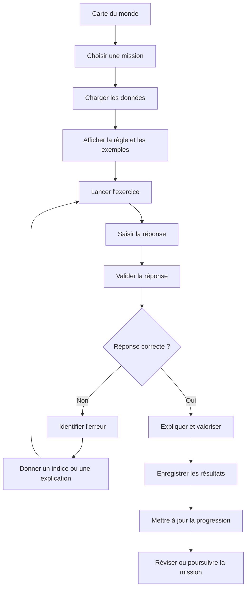

# Cycle de vie d'un exercice

Transcription du diagramme joint au cahier des charges (§7), suivie de la répartition des responsabilités et de deux écarts à trancher avant de coder.

## Diagramme d'origine

## Qui fait quoi

| Étape | Responsable | Remarque |
|---|---|---|
| Carte du monde, choisir une mission | scène `world_map`, navigation par `GameManager` | |
| Charger les données | `ExerciseEngine` | JSON validé contre le schéma avant usage |
| Afficher la règle et les exemples | `rule_panel` | contenu issu de `data/rules/` |
| Lancer l'exercice, saisir la réponse | `exercise_host` et la scène du type d'exercice | la scène émet la réponse par signal, rien d'autre |
| Valider la réponse, identifier l'erreur | `answer_validator`, `dictation_analyzer` | code pur, renvoie la structure de correction du §6 |
| Indice, explication, valorisation | `feedback_panel` | affiche la structure de correction, ne calcule rien |
| Enregistrer, mettre à jour la progression | `ProgressManager`, puis `SaveManager` | |
| Réviser ou poursuivre | `review_scheduler`, `difficulty_manager` | code pur |

## Écarts avec le cahier des charges

Les résolutions ci-dessous sont des propositions. Elles sont à confirmer à l'étape de plan, puis à consigner dans `decisions.md`.

### 1. La branche « Non » n'enregistre rien

Dans le diagramme, seul un succès mène à « Enregistrer les résultats ». Or le §9 demande, par compétence, le nombre de tentatives, les erreurs fréquentes et le niveau d'aide utilisé : ces indicateurs ne peuvent pas être calculés si les échecs ne laissent aucune trace.

Proposition : chaque validation, juste ou fausse, produit un enregistrement de tentative (exercice, règle, résultat, erreurs identifiées, aide utilisée) transmis à `ProgressManager`. L'écriture sur disque reste groupée en fin de mission, conformément au §10.

### 2. La boucle d'erreur n'a pas de sortie

« Donner un indice ou une explication » renvoie à « Lancer l'exercice » sans limite. Un enfant qui ne trouve pas reste bloqué sur la même question, ce qui contredit le principe 3 du §2 (ne pas bloquer durablement).

Proposition : aide graduée, puis sortie.

1. Première erreur : indice (`hint`), nouvelle tentative.
2. Deuxième erreur : explication de la règle, nouvelle tentative.
3. Troisième erreur : la réponse corrigée est montrée avec son explication, l'exercice se termine sans sanction et la compétence est marquée pour une révision avec d'autres exemples.

Le nombre de tentatives est un paramètre, pas une constante en dur.
